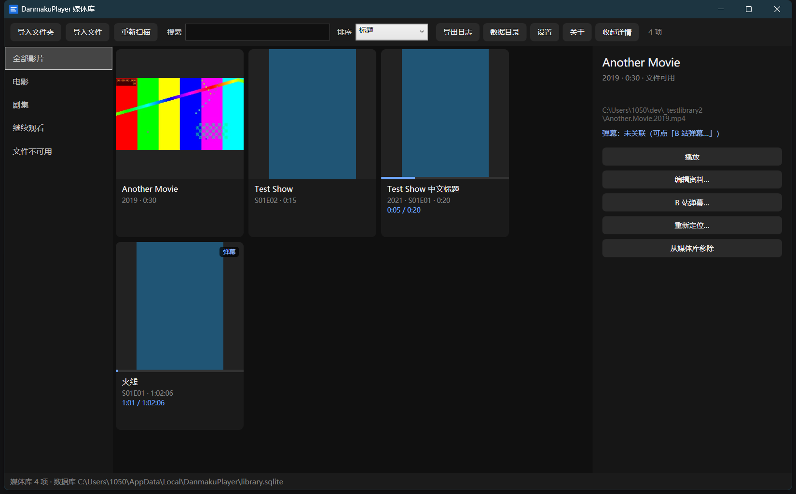
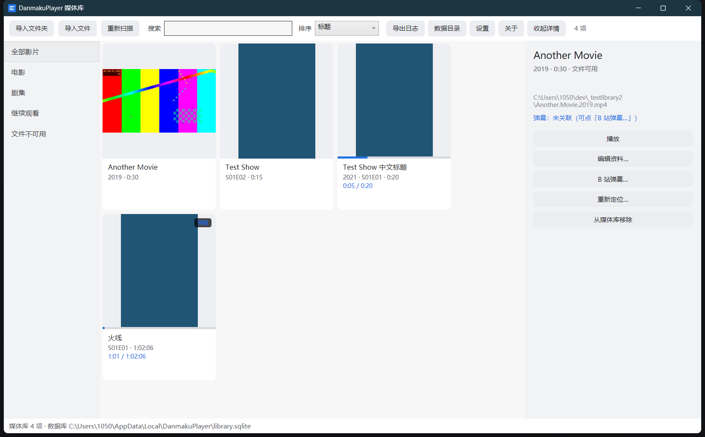
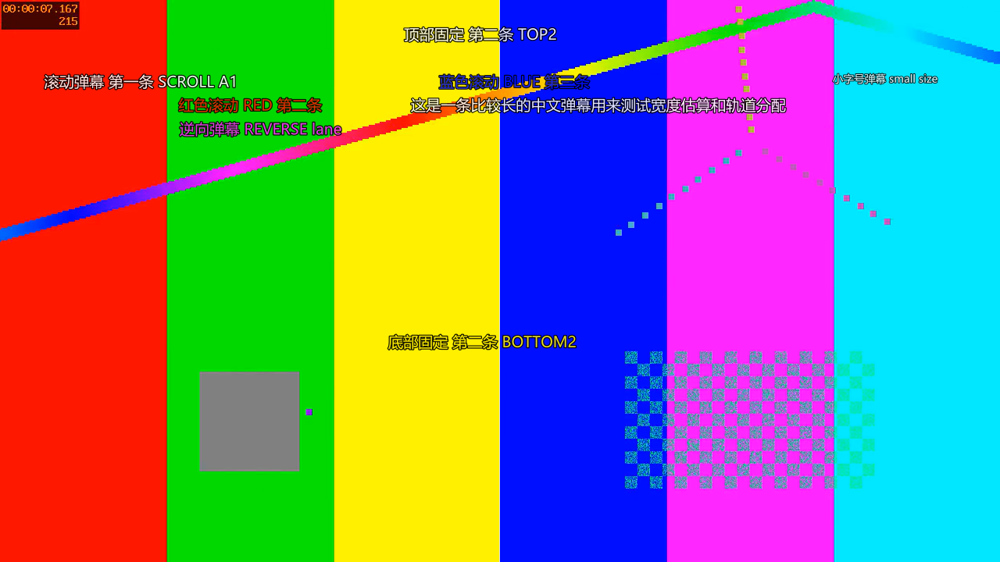

# DanmakuPlayer for Windows

Windows 上的本地视频播放器 + B 站弹幕。用 **.NET 8 + WPF + libmpv** 实现：视频由 libmpv 渲染，
弹幕生成 ASS 交给 libass 叠加，界面是原生 WPF。

这个仓库是 [DanmakuPlayer](https://github.com/yej07243-lang/DanmakuPlayer)（macOS 版）的 Windows 移植。







## 功能

**媒体库**
- 导入文件夹或视频文件（支持拖放、多选），递归扫描，扩展名覆盖 mp4/mkv/mov/avi/webm/m4v/ts/m2ts/flv/wmv/mpg/mpeg；跳过隐藏/系统文件和目录
- 文件名解析 `S01E01` 与年份；读取容器内置标题和片长（ffprobe 优先，缺失时用随包 libmpv 兜底）；有 NFO 时读 title/year/season/episode/plot；本地海报优先，没有就用 ffmpeg 抽帧生成缩略图
- 分栏：全部影片 / 电影 / 剧集 / 继续观看 / 文件不可用；搜索；按标题或最近播放排序；「剧集」按片名分组
- 继续观看与「已看完」（进度 > 95% 自动标记）、编辑影片资料（含手动选择海报）、重新定位、从库移除（不动源文件）
- 海报卡片显示已看完/弹幕角标和续播进度条；详情显示时长、季集、简介、文件名和续播保存时间
- 工具栏/右键菜单/快捷键：`Ctrl+O` 导入文件、`Ctrl+Shift+O` 导入文件夹、`Ctrl+F` 搜索、`Enter` 播放选中；窄窗自动收起右侧详情
- SQLite 存储，结构为 `media(id, path, payload JSON)` + `roots(path)`

**播放**
- libmpv 播放，硬件解码（`hwdec=auto-safe`），多音轨与内嵌字幕
- 进度条拖拽、±5 秒、倍速、音量/静音、真全屏（无边框铺满显示器，`F` 切换、`Esc` 退出）
- 外挂字幕（SRT/ASS/VTT/SSA）：同名文件由 mpv 自动发现并挂到次字幕轨，也可手动选择；字幕提前/延后 0.1 秒
- 播放列表菜单、播放时阻止系统休眠、系统休眠前自动暂停并保存进度、错误横幅
- 续播约每 5 秒保存一次；进度过 95% 自动标记已看完，再看时从头开始；同一时间只保留一个播放窗口

**弹幕**
- B 站 XML（滚动/顶部/底部/逆向、颜色、字号），超过 64 MB 或损坏的 XML 给出明确错误
- 字号、透明度、显示区域、滚动速度、同屏上限、屏蔽词、滚动/顶部/底部开关
- 字体（微软雅黑/黑体/宋体/仿宋/等线/楷体），默认微软雅黑 + **粗体**、全不透明、同屏上限 40、描边 10% 字号 + 1px 阴影（暗景亮景都能看清）
- 整体延后（按影片保存，正数=更晚出现）+ **分段校准锚点**：两版片长不同时按段对齐，改锚点热更新不打断播放
- 设置窗口分「显示 / 时间校准 / 来源与缓存」三页，来源页可导入本地 XML、切换 B 站来源、刷新或清除缓存

**外观与系统**
- 主题默认跟随 Windows 的浅色/深色设置（`AppsUseLightTheme`），可在「设置」里锁定浅色或深色；视频画面不受主题影响
- 全局字体统一为 Microsoft YaHei UI；自定义模板的按钮补了键盘焦点描边，主要控件带无障碍名称
- 「设置」里有版本号、关于窗口、打开数据目录和诊断日志导出

**B 站**
- 链接：BV / av / ep / ss / b23.tv 短链，`p=` 预选分 P，自动列出分 P 或整季分集
- 搜索：关键词视频搜索与官方影视搜索（WBI 签名 + 游客 cookie）；默认带入本地标题，官方影视自动补季数
- 弹幕缓存（`danmaku-cache/<cid>.xml`）、刷新、清除；载入后写成 `<视频>.xml` 边车，下次自动带弹幕
- 换弹幕来源会提示并重置该影片的分段校准；清缓存会同时解除媒体库里的 B 站来源记录

## 与 macOS 版的功能对照

对照 `DanmakuPlayer-macOS-Feature-Inventory.md` 逐项核对的结果。功能入口以 Windows 的工具栏、右键菜单和快捷键为准。

| 范围 | Windows 现状 | 平台差异 |
| --- | --- | --- |
| 媒体库界面 | 三栏布局、五个分类、搜索、排序、剧集分组、海报角标/进度条、详情续播时间 | 没有 macOS 菜单栏，用工具栏 + 右键菜单承载同样入口 |
| 导入与扫描 | 多选/拖放导入、递归、隐藏文件跳过、重扫合并、NFO/海报/缩略图、容器标题、手动编辑、失效与重新定位 | HEIC 海报依赖系统 HEIF 解码器 |
| 播放与字幕 | libmpv、硬解、切轨、外挂字幕自动发现、字幕延迟、续播、已看完、防休眠、休眠暂停、错误横幅 | 同一时间只保留一个播放窗口 |
| B 站来源 | 链接/搜索/官方影视/分 P 预选/缓存/刷新/清除/换源重置校准 | 缓存使用 `list.so` XML，不解析分段 protobuf |
| 弹幕显示 | 三页设置、全部显示项、字体、屏蔽词、密度与轨道避让 | 字体列表取 Windows 自带字体 |
| 时间校准 | 整体延后（按影片保存）+ 锚点列表 + 当前播放位置打点 + 热更新 | 校准存 `calibration.json`，macOS 存 SQLite 记录 |
| 数据与诊断 | SQLite WAL、数据目录、日志导出、备份、版本查看、自包含安装包 | 数据目录为 `%LOCALAPPDATA%\DanmakuPlayer` |

macOS 版「应用运行时接收 Finder 打开请求」在 Windows 上未实现：带文件启动会新开一个播放窗口。

## 下载与运行

到 [Releases](../../releases?q=windows) 下载 `DanmakuPlayerWin-<版本>-win-x64.zip`，解压后运行
`DanmakuPlayerWin.exe`。发布包自带 .NET 运行时，不需要另外安装。

首次启动是空的媒体库：点「导入文件夹」，或者把视频/文件夹拖进窗口。双击卡片开始播放。

## 弹幕怎么来

1. 播放器里点「B 站链接…」：粘链接（或只填 BV/ep/ss 编号），或直接搜关键词，选中分集后载入。
2. 媒体库里选中条目点「B 站弹幕…」，载入后会写回条目的来源信息。
3. 已有本地 XML 时，播放器「弹幕 XML」会复制成同名边车并加载；同名 `.xml` 边车打开视频时自动加载。

片长和 B 站版本不一致时（常见于国内外不同剪辑），在播放器里点「校准…」：
B 站播放器停在某个画面记下时间，本地暂停在同一画面，填进去加锚点；两个以上锚点可以按段对齐。

## 数据目录

默认 `%LOCALAPPDATA%\DanmakuPlayer`，可用环境变量 `DANMAKU_DATA_DIR` 整体改到别处。
少数机器或远程会话里 WPF 的 D3D 渲染会失效（窗口整片白），设置 `DANMAKU_SOFTWARE_RENDER=1`
可强制软件渲染，仅用于排查和截图。

| 文件 | 内容 |
| --- | --- |
| `library.sqlite` | 媒体库 |
| `resume.json` | 每个文件的播放位置和已看完状态 |
| `calibration.json` | 整体延后与分段校准锚点 |
| `danmaku-settings.json` | 弹幕显示设置 |
| `danmaku-cache/` | B 站弹幕缓存 |
| `thumbnails/` | 自动生成的缩略图 |
| `diagnostics.log` | 诊断日志（媒体库工具栏可导出） |

备份或迁移：退出应用后整体复制该目录。

## 从源码构建

需要 Windows 10/11 x64 与 .NET SDK 8.0，另外要准备 `libmpv-2.dll`：

```powershell
# 1) 取 libmpv（x86_64 构建，含 FFmpeg/libass）
#    例如 zhongfly/mpv-winbuild 的 mpv-dev-x86_64-*.7z，解压出 libmpv-2.dll
# 2) 放到 windows\libmpv\libmpv-2.dll（或在构建时指定 -p:LibMpvDir=<目录>）

dotnet build -c Debug
.\bin\Debug\net8.0-windows\DanmakuPlayerWin.exe
```

发布包构建步骤见 [docs/RELEASE.md](docs/RELEASE.md)。

## 命令行

自检（不点界面也能核对功能）：

```powershell
# 播放 + 弹幕 + 定点截图，结果写 JSON
.\DanmakuPlayerWin.exe --selftest "D:\videos\demo.mp4" --danmaku media\selftest-danmaku.xml --at 6 --report logs\selftest.json

# 只验校准映射（23 项纯函数用例）
.\DanmakuPlayerWin.exe --check-calibration

# 只验重新定位的数据迁移（进度/校准/弹幕边车）
.\DanmakuPlayerWin.exe --check-maintenance

# 扫描入库 / 读库
.\DanmakuPlayerWin.exe --scan "D:\videos"
.\DanmakuPlayerWin.exe --library

# B 站搜索
.\DanmakuPlayerWin.exe --bili-search "火线"
.\DanmakuPlayerWin.exe --bili-search "火线" --official
```

`scripts/make-fixtures.ps1` 会生成自检用的合成视频与夹具（路径相关的夹具不进仓库）。

## 已知限制

- 只做 x64；ARM64 未构建。
- 音频只验证到 WASAPI 输出链路建立，没有自动化验证物理出声。
- 弹幕缓存用 `list.so` 的 XML（macOS 版用分段 protobuf），内容等价但不解析 protobuf。
- 校准锚点需要人工打；程序不会自动探测两版剪辑差异。
- 外挂字幕延迟作用于次字幕轨（用户字幕），弹幕主轨靠整体延后调整。
- 媒体库按绝对路径记录；文件改名或移动后需要「重新定位」（进度、校准和弹幕边车会一起迁移）。
- 自动缩略图需要系统 PATH 里有 `ffmpeg`；没有时用占位图，片长仍由随包 libmpv 读取。
- 应用已在运行时，再双击视频会新开一个窗口，不会转发给现有实例。

详细的验证记录见 [docs/VERIFICATION.md](docs/VERIFICATION.md)，UI 计划逐项对照见 [docs/UI-PLAN-STATUS.md](docs/UI-PLAN-STATUS.md)。

## 许可

**GPL-3.0-or-later**，见 [LICENSE](LICENSE)。随包分发的 libmpv 构建启用了 GPL 组件（如 x264），
所以整体按 GPL 分发。第三方组件、版本与对应源码地址见 [THIRD-PARTY-NOTICES.md](THIRD-PARTY-NOTICES.md)。

## 致谢

- [mpv](https://mpv.io/) / [libass](https://github.com/libass/libass) / [FFmpeg](https://ffmpeg.org/)
- [zhongfly/mpv-winbuild](https://github.com/zhongfly/mpv-winbuild) 提供的 Windows 构建
- macOS 版 DanmakuPlayer 的产品设计与校准语义
